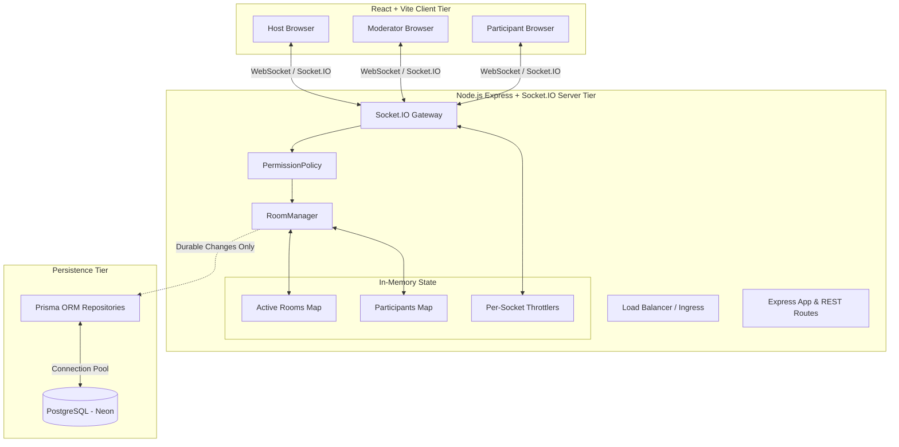

# WatchParty System Architecture

This document provides a technical deep-dive into the architectural patterns, state synchronization algorithm, security model, and scalability considerations of WatchParty.

---

## 1. High-Level System Overview



---

## 2. WebSocket Event & Data Flow

```mermaid
sequenceDiagram
    autonumber
    actor Participant as Participant
    actor Host as Host
    participant Server as Socket.IO Server
    participant Policy as PermissionPolicy
    participant Room as Room (In-Memory)
    participant DB as PostgreSQL (Prisma)

    Host->>Server: join_room { roomId, username }
    Server->>Room: Add Host Participant
    Server->>DB: Upsert Member (Role: HOST)
    Server-->>Host: sync_state (initial video, state, participants)

    Participant->>Server: join_room { roomId, username }
    Server->>Room: Add Participant (Role: PARTICIPANT)
    Server->>DB: Upsert Member (Role: PARTICIPANT)
    Server-->>Participant: sync_state
    Server-->>Host: user_joined { user }

    Host->>Server: play { currentTime: 45.2 }
    Server->>Policy: can("PLAY", { actorRole: "HOST" })
    Policy-->>Server: true
    Server->>Room: applyPlay(45.2)
    Server-->>Participant: sync_state { playState: "PLAYING", currentTime: 45.2, updatedAt }

    Participant->>Server: request_action { actionType: "PAUSE", targetTime: 50 }
    Server->>Policy: can("REQUEST_ACTION", { actorRole: "PARTICIPANT" })
    Policy-->>Server: true
    Server->>Room: addRequest(...)
    Server-->>Host: action_requested { id, username, actionType }

    Host->>Server: approve_request { requestId }
    Server->>Policy: can("APPROVE_REQUEST", { actorRole: "HOST" })
    Policy-->>Server: true
    Server->>Room: removeRequest & applyPause(50)
    Server-->>Participant: sync_state { playState: "PAUSED", currentTime: 50 }
    Server-->>Host: sync_state { playState: "PAUSED", currentTime: 50 }
```

---

## 3. Real-Time Synchronization Algorithm

### A. Timestamp Calculation
Traditional video synchronization systems send frequent position packets over WebSockets (e.g. 5 times per second), creating unnecessary CPU overhead, packet congestion, and jitter.

WatchParty uses an **epoch-based timestamp delta** model:
1. When playback begins or resumes, the server captures `currentTime` (in seconds) and `updatedAt = Date.now()` (ms).
2. Any client or server node can calculate current live video time at any moment $t_{now}$ using:
   $$\text{LiveTime} = \begin{cases} \text{currentTime} + \frac{t_{now} - \text{updatedAt}}{1000}, & \text{if } \text{playState} = \text{PLAYING} \\ \text{currentTime}, & \text{if } \text{playState} = \text{PAUSED} \end{cases}$$
3. This eliminates continuous position broadcasting. Broadcasts occur **only on state transitions** (play, pause, seek, change video).

### B. Client Drift Correction Loop
Every 2 seconds, the client player checks the local YouTube player position against the calculated expected time:
$$\Delta = | t_{\text{player}} - \text{LiveTime} |$$
- If $\Delta \le 1.5\text{s}$: No action taken (prevents audible audio micro-stuttering or micro-seeking).
- If $\Delta > 1.5\text{s}$: The client triggers a hard seek `player.seekTo(LiveTime, true)`.

### C. Echo Loop Suppression
When the YouTube player's state change listener fires in response to an automated programmatic seek or play/pause command, the client sets an internal flag `isProgrammaticAction = true` for 500ms. This prevents the client from emitting a reflected socket event back to the server, eliminating infinite echo loops.

---

## 4. In-Memory vs. Database Split

| Aspect | In-Memory (Node.js Heap) | Database (PostgreSQL / Neon) |
| :--- | :--- | :--- |
| **Data Kept** | `currentTime`, `playState`, `updatedAt`, socket mapping, pending requests, reconnect tokens, active participant maps. | Room code, host ID, persistent members, banned users, audit logs, optional chat archive. |
| **Write Frequency** | Immediate (sub-millisecond) on every playback mutation. | Durable changes only: room creation, host transfer, role change, ban, video change. |
| **Failure Handling** | Server restart triggers on-demand hydration from DB upon `join_room`. | Atomic transactions (`prisma.$transaction`) with retry fallback. |
| **Privacy Guarantees** | Reconnect tokens and socket IDs never leave RAM. | Zero IPs, zero tokens, zero email addresses stored. |

---

## 5. Architectural Trade-offs & Decisions

1. **In-Memory Playback State vs. Redis Cache**
   - *Decision:* Kept single-instance in-memory state for initial architecture rather than mandatory Redis dependency.
   - *Advantage:* Minimal infrastructure cost, zero external round-trip network latency on playback events, simple local development.
   - *Trade-off:* Multi-instance horizontal scaling requires a pub/sub layer.

2. **Server-Side Video ID Extraction**
   - *Decision:* Clients send arbitrary YouTube URLs or 11-char IDs; server extracts and validates the 11-character identifier via strict regex.
   - *Advantage:* Defends against malicious iframe URLs, SSRF attacks, and invalid video payloads.

3. **Demote to Moderator on Host Transfer**
   - *Decision:* When a Host transfers host ownership to another user, the former host is atomically demoted to Moderator.
   - *Advantage:* Prevents room deadlocks where a room creator would otherwise be demoted to a regular participant with no moderation tools.

---

## 6. Horizontal Scaling with Socket.IO Redis Adapter

When scaling out across multiple server instances (e.g. multiple Kubernetes pods or multiple Render Web Service instances), room sockets can be connected across different nodes.

To scale horizontally:
1. **Socket.IO Redis Streams / Cluster Adapter**:
   ```ts
   import { createAdapter } from '@socket.io/redis-adapter';
   import { createClient } from 'redis';

   const pubClient = createClient({ url: process.env.REDIS_URL });
   const subClient = pubClient.duplicate();
   await Promise.all([pubClient.connect(), subClient.connect()]);

   io.adapter(createAdapter(pubClient, subClient));
   ```
2. **Sticky Sessions (Session Affinity)**:
   Configure the ingress load balancer to use IP or cookie-based session stickiness during HTTP polling upgrades (or force `transports: ['websocket']`).
3. **Distributed In-Memory Room State**:
   Store the active room metadata hash in Redis (`HSET room:<id> videoId ... currentTime ... updatedAt ...`) with a 1-day TTL, using atomic Lua scripts for state changes.
